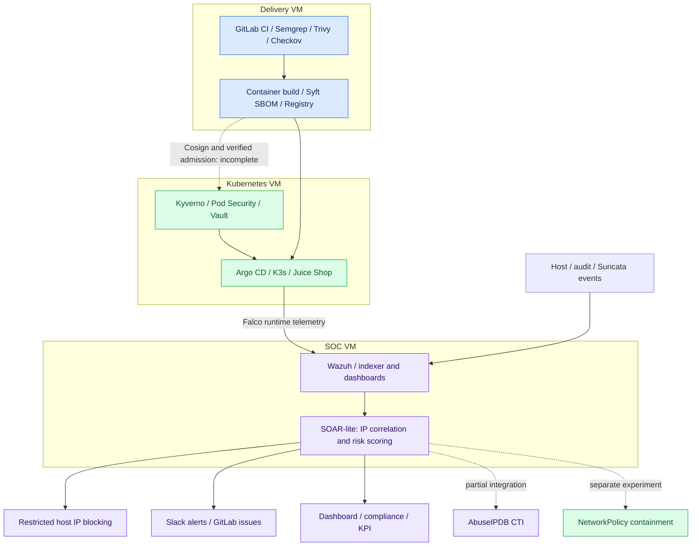

<div align="center">

# PipeGuard

### From secure delivery to risk-driven incident response

**A cloud-native DevSecOps & SOC engineering lab**


[](https://github.com/houssam-ops/pipeguard-devsecops-lab/actions/workflows/repository-checks.yml)

[Architecture](#architecture) · [Security workflow](#security-workflow) · [Results](#results-and-evidence) · [Get started](#get-started) · [Roadmap](#roadmap)

</div>

---

PipeGuard explores a practical security engineering question: **how can a small cloud-native lab connect preventive CI/CD controls with contextual detection and automated containment?**

Developed as an academic end-of-year cybersecurity project (PFA), the lab brings together GitLab CI, Kubernetes security controls, runtime and host telemetry, and a Python SOAR-lite service. Its central contribution is a risk-driven workflow that correlates alerts, assigns severity and triggers a proportionate response.

> [!IMPORTANT]
> **Public release scope:** this repository contains an engineering case study, selected code and configuration excerpts recovered from the project execution guide, and new repository validation tooling. The final deployed SOAR service, complete infrastructure configuration and raw measurement dataset were not supplied. This is a **partial source release**, not a one-command deployment of the original lab. Each recovered artifact is identified in [Source provenance](docs/source-provenance.md).

## Engineering highlights

- **Security across delivery and runtime:** connect SAST, dependency and infrastructure scanning to Kubernetes admission controls and operational detection.
- **Contextual incident prioritization:** combine alert severity, MITRE ATT&CK context and repeated activity rather than treating every alert independently.
- **Automated response with boundaries:** the report describes IP blocking with exclusions and duplicate suppression; a separate Kubernetes containment experiment is also documented.
- **Secret management:** Vault integration for application secrets and SOAR integration credentials; no real secret values are distributed here.
- **Measurable behavior:** distinguish ingestion latency from response-action timing and from end-to-end incident resolution.
- **Evidence-aware engineering:** explicitly track unvalidated integrations, conflicting source descriptions and missing artifacts.

## Architecture

A single virtualization host runs three functional VMs: delivery services, Kubernetes workloads and SOC services. This is a laboratory topology with no high-availability claim. The diagram intentionally omits original network addresses, hostnames and organization details.



Solid connections summarize the documented design and lab integrations, not independently reproduced deployment evidence. Dashed connections identify qualified or incomplete paths. GitHub hosts this portfolio; **GitLab was the lab's CI/CD and incident-ticket platform**.

## Technology stack

- **Infrastructure:** Linux VMs, VirtualBox, Ansible, K3s, Docker.
- **Delivery security:** GitLab CE/Runner/Registry, Semgrep, Trivy, Checkov, Syft; Cosign signing is described but the end-to-end signature enforcement chain is incomplete.
- **Workload security:** Kyverno, Kubernetes Pod Security Standards, NetworkPolicy, HashiCorp Vault.
- **Detection and investigation:** Falco, Wazuh and its OpenSearch-based indexing/dashboard stack, Suricata, Kubernetes audit logs, MITRE ATT&CK.
- **Response and integration:** Python, Flask, systemd, Vault client integration, Slack webhooks, GitLab issues; AbuseIPDB coverage is qualified below.
- **Demonstration target:** OWASP Juice Shop, a deliberately vulnerable application used only in an isolated lab. Its source is not vendored here.

Keycloak, Prometheus/Grafana, ZAP, advanced SOC dashboards and optional network extensions appear in the planning guide. They are **not claimed as validated deliverables** in this release.

## Security workflow

1. **Model threats:** identify trust boundaries and apply STRIDE to the delivery pipeline, cluster, secrets and response mechanisms.
2. **Inspect changes:** run source, dependency/secret and infrastructure scans; retain findings as reviewable artifacts. The recovered pipeline has differing enforcement behavior by tool, detailed in [Setup](docs/setup.md).
3. **Track artifacts:** build identifiable container images and generate an SBOM. Signing is part of the design; verified admission of signed images remains an open item.
4. **Constrain workloads:** apply admission rules, pod security settings and network controls; manage secrets through Vault.
5. **Observe and correlate:** combine runtime, host and network signals through the SOC pipeline and group repeated activity.
6. **Score and respond:** prioritize incidents and trigger scoped response actions, notifications and tickets.
7. **Validate outcomes:** verify actual containment and record timing boundaries. A successful API call alone does not prove traffic was blocked.

### Two scoring models, clearly separated

**Reported implementation (IP-oriented).** The implementation chapter describes a 10-second correlation window keyed by source IP, with a score on a 0–10 scale:

```text
score = min(10, (min(wazuh_level, 15) / 15) * 10
                + mitre_weight + min(alert_count - 1, 5))
```

The documented bands are low (<3), medium (3–<6), high (6–<8) and critical (≥8). Critical incidents can invoke a restricted blocking script. The final service and complete weight mapping are unavailable, so this formula is documented rather than reimplemented as alleged original source. Some report demonstrations use a 0–100 display; normalization and exact version alignment remain unverified.

**Recovered guide prototype (pod-oriented).** The available Python excerpt groups events by `(namespace, pod)`, uses a 30-minute linear decay, caps the score at 100 and defines notification/isolation thresholds of 40/70. CTI and notification code are incomplete. The prototype is preserved as an inert `.py.example` for code review, with [known limitations](docs/prototype-review.md). It is not the final IP-oriented implementation.

## Results and evidence

These are **preliminary measurements reported from functional lab tests**, not benchmarks reproduced from this public checkout:

- **Approximately 1.9 seconds median ingestion latency:** alert-generation timestamp to SOAR receipt. This measures integration latency, not attack-to-detection MTTD.
- **116.5–330.5 milliseconds reported blocking-action time:** a narrow automated-response measurement, not full incident investigation or recovery time. The report's timing descriptions vary between receipt-to-completion and already-scored-to-completion; raw instrumentation is needed to resolve the boundary.
- **Qualitative demonstrations:** runtime/host/network alerting, risk-score responses, host blocking, Slack notifications, GitLab ticket creation and a live risk dashboard are documented in the report.

The report does not provide a reproducible raw dataset, sample count or statistical uncertainty for these values. No speedup versus a human SOC is claimed. A formal Purple Team campaign was not completed. No screenshot, recording or operational log is included in this release.

### What remains qualified

- **Signature verification:** the detailed implementation section says the Kyverno `verifyImages` policy remains to be written, despite broader completion language elsewhere.
- **GitOps:** an Argo CD `OutOfSync` state remained unexplained in the recorded demonstration.
- **CTI:** individual AbuseIPDB demonstrations are described, while the limitations chapter calls the integration partial. Full coverage is unverified.
- **Incident lifecycle and reversal:** `NEW → INVESTIGATING → CONTAINED → CLOSED` and `/unisolate` were described as implemented but awaiting end-to-end validation.
- **Network containment:** policy creation was demonstrated; effective isolation under existing allow policies was not established by that evidence alone.
- **Vault:** manual unseal remained necessary; incident-linked lease revocation and dynamic database credential rotation were not implemented.
- **Compliance:** rule-to-framework mappings provide evidence organization, not compliance certification or proof that every control is satisfied.

## Get started

### Inspect the public release safely

Requires Git and Python 3.10 or later for the local validation tools. The recovered KPI helper uses only the Python standard library.

```bash
git clone https://github.com/houssam-ops/pipeguard-devsecops-lab.git
cd pipeguard-devsecops-lab

# Validate publication boundaries and Python syntax; does not deploy anything.
python3 scripts/validate_repository.py

# Exercise the recovered KPI helper with explicitly synthetic test data.
python3 -m unittest discover -s tests -v
```

### Rebuild the lab in stages

A complete installation is not possible from the provided artifacts alone. [Setup and recovery requirements](docs/setup.md) describes prerequisites, component order and the missing inputs needed for a faithful rebuild.

The original plan budgets a 16 GB host with three Linux VMs and approximately 2/4/4 GB RAM for delivery/platform/SOC roles. This is a planning budget, not a validated capacity recommendation for current releases. Dependency versions and lockfiles were not supplied.

Do not apply the whole `examples/` tree recursively. Review one excerpt at a time, resolve its prerequisites and test in a disposable lab. The archive includes incomplete historical code and is deliberately not enabled as a live pipeline or responder.

## Demonstrations

**Available now:** inspect the recovered source, validate repository hygiene and run the synthetic KPI unit tests. Test fixtures are explicitly labeled and are not research measurements.

**When the final lab source is recovered:** follow the [demonstration runbook](docs/demo-runbook.md) to capture a low-risk alert, a critical incident, verified containment and a complete recovery path. Preserve sanitized evidence with exact versions and measurement boundaries before marking a scenario as validated.

## Repository map

```text
.
├── README.md
├── SECURITY.md
├── docs/
│   ├── source-provenance.md    # What is recovered, missing and newly authored
│   ├── setup.md                # Installation boundaries and rebuild sequence
│   ├── prototype-review.md     # Technical limitations of recovered snippets
│   └── demo-runbook.md         # Future evidence collection, not claimed results
├── examples/
│   ├── ansible/                # Recovered hardening playbook
│   ├── kubernetes/             # Recovered default-deny policy
│   ├── detection/              # Recovered Falco rule and Wazuh SCA snippet
│   ├── pipelines/              # Inactive GitLab scan-stage example
│   └── soar/                   # Inert historical responder source
├── metrics/                    # Recovered KPI calculation helper
├── scripts/                    # New publication hygiene checks
├── tests/                      # New synthetic tests for the recovered helper
└── .github/workflows/          # Checks for this public repository only
```

## Roadmap

- [ ] Recover, sanitize and publish the final IP-oriented SOAR service and deployment dependencies.
- [ ] Reconcile score normalization, weights, correlation semantics and timestamp boundaries against the deployed version.
- [ ] Complete signed-image admission checks and resolve GitOps drift.
- [ ] Validate incident state transitions, rollback, exclusions, duplicate handling and effective network containment.
- [ ] Add authenticated ingestion, bounded durable state and tests for malformed/replayed alerts.
- [ ] Record a repeatable Purple Team campaign with sample counts, raw sanitized timings and false-positive analysis.
- [ ] Establish a pinned compatibility matrix and reproducible infrastructure build.
- [ ] Evaluate Vault auto-unseal, least-privilege service identities and multi-node resilience.

## Responsible use and publication

Use defensive experiments only in systems you own or are explicitly authorized to test. Keep Juice Shop and response services isolated from production and the public Internet.

The private academic report, original execution guide, screenshots, credentials, personal details and original infrastructure identifiers are excluded. See [Security and publication policy](SECURITY.md). No open-source license is asserted for recovered project material; licensing should be resolved by the rights holder before granting reuse rights.
